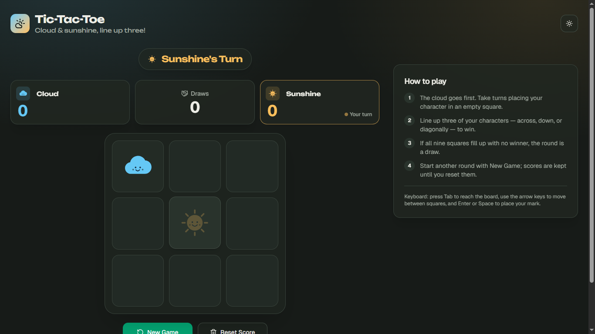
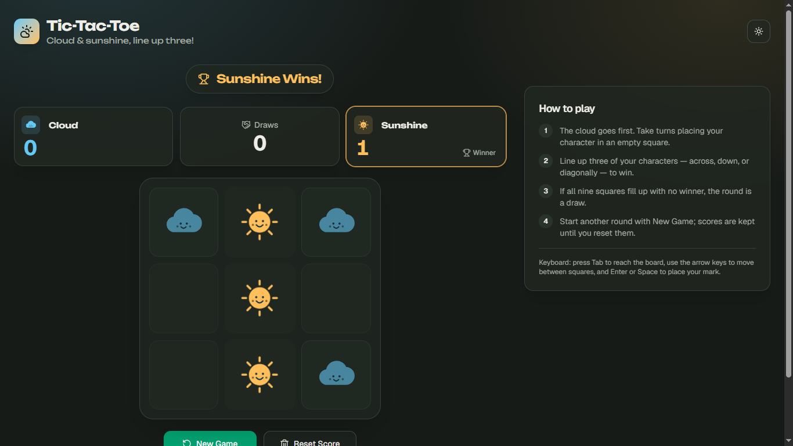
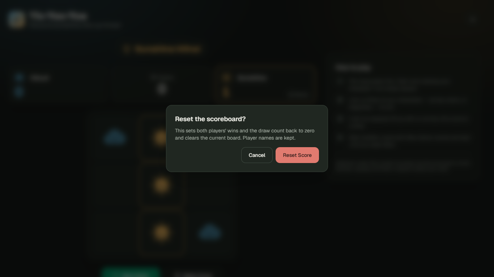
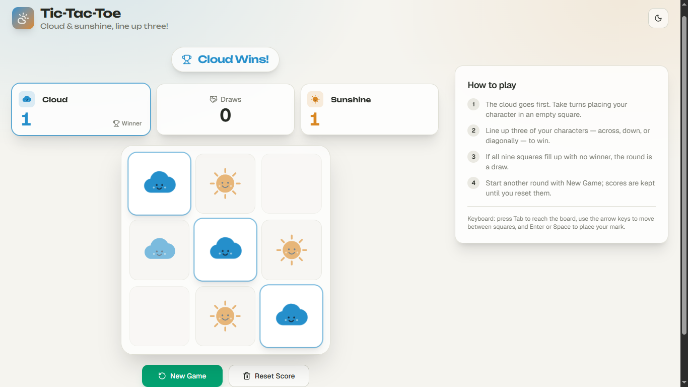

# Tic-Tac-Toe

A two-player Tic-Tac-Toe game with a 3×3 board, cloud and sunshine characters, a scoreboard, and customizable player names. Built with **Next.js (App Router), React 19, TypeScript, Tailwind CSS v4**, and shadcn/ui-style components using Radix primitives. Includes Lucide icons and does not require a backend or database.

  
  
  
  

## Features

- **Game Board:** A 3×3 grid with cloud and sunshine characters. Cloud takes the first turn.
- **Game Rules:** Prevents players from selecting occupied cells or making moves after a round ends.
- **Win Detection:** Checks all eight possible winning combinations, highlights the winning cells with a pulse animation, and detects draws.
- **Scoreboard:** Tracks wins for both players and the number of draws. Highlights the player whose turn it is.
- **Player Names:** Allows players to change their names from the default Cloud and Sunshine. Updated names also appear in game status messages.
- **Game Controls:** New Game starts another round without clearing the scores. Reset Score asks for confirmation before clearing the scores and board.
- **Theme Toggle:** Starts in dark mode and allows switching to light mode. The selected theme is saved in `localStorage`.
- **Accessibility and Responsive Design:** Supports different screen sizes, keyboard navigation using Tab and arrow keys, Enter and Space controls, ARIA labels, live status announcements, and reduced-motion preferences.

## Run Locally

Requires Node.js 20.9 or newer.

\`\`\`bash
npm install
npm run dev
\`\`\`

Open [http://localhost:3000](http://localhost:3000) in your browser.

### Available Scripts

\`\`\`bash
npm run build       # Build for production
npm start           # Start the production server
npm run lint        # Run ESLint
npm run typecheck   # Check TypeScript types
npm test            # Run game logic tests (22 cases)
\`\`\`

## Project Structure

\`\`\`text
src/
├── app/              # Layout, page, global styles, icon
├── components/       # Header, Game, GameBoard, GameCell,
│                     # ScoreBoard, PlayerCard, GameStatus,
│                     # GameControls, GameInstructions,
│                     # Footer, ThemeToggle
│   └── ui/           # Button, card, input, label, alert-dialog
├── hooks/
│   └── use-game      # useReducer wrapper for game state
└── lib/
    └── game.ts       # Game logic and types
tests/                # Game logic tests
\`\`\`

## Game Logic

The game logic is handled in `src/lib/game.ts` using a pure reducer, separate from the UI components. The `use-game` hook connects the reducer to the interface.

Game actions include `move`, `newGame`, `resetScore`, and `setName`. The reducer handles turn changes, win and draw detection, and score updates. It also prevents invalid moves and ensures that each completed round is counted only once.

## Deployment

The project can be deployed to Vercel without additional configuration since Next.js is automatically detected.

### Using GitHub

1. Push the project to a GitHub repository.
2. Open Vercel and select **Add New → Project**.
3. Import your repository.
4. Click **Deploy**.

### Using Vercel CLI

\`\`\`bash
npm install -g vercel

vercel          # Preview deployment
vercel --prod   # Production deployment
\`\`\`